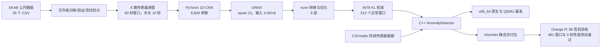

# ARM64 端侧 AI 异常检测部署

当前版本：**v1.0.0**。发布范围、真机数据和已知限制见
[v1.0.0 发布说明](docs/RELEASE_NOTES_v1.0.0.md)。

本仓库公开源码、文档、测试和经过审核的真机性能基线，不附带 SKAB 原始数据、
模型二进制或包含派生测试夹具的 ARM64 交付包。文中出现的本地交付包 SHA-256
用于标识已完成真机验证的构建，不代表 GitHub Release 提供该二进制附件。

把公开设备时序数据上的轻量异常检测模型，从 PyTorch 训练一路部署到
AArch64 Linux 的 C++/ncnn 推理程序，并记录可复现的精度、延迟和内存数据。

项目重点不是追求复杂模型，而是验证完整的端侧部署链路：

> 公开数据 -> 数据审计 -> 滑窗数据集 -> 轻量模型 -> ONNX -> ncnn INT8
> -> C++ 封装 -> ARM64 静态交付包 -> 真机验收

当前真机目标为 **Orange Pi 3B 4GB（RK3566）**。Debian 12 Server 镜像已写入
64GB microSD，板端精度验收和 5 轮性能采集均已完成。仓库中的 Orange Pi
数据为真实硬件实测，并与 QEMU 模拟数据分栏记录。

项目代码采用 [Apache License 2.0](LICENSE)，第三方组件与数据许可证见
[THIRD_PARTY_NOTICES.md](THIRD_PARTY_NOTICES.md)。

最后更新：2026-11-13

## 架构



单窗口处理流程：

1. 接收 `[60, 8]` 时间优先传感器窗口。
2. 使用训练集正常基线计算出的均值和标准差标准化。
3. 转为 ncnn 的 `[8, 1, 60]` 通道优先布局。
4. 执行 INT8 推理并做 Sigmoid。
5. 使用验证集固定阈值输出异常判定。

## 当前状态

| 阶段 | 状态 | 说明 |
|---|---|---|
| 数据审计与滑窗 | 已完成 | 文件级隔离，避免同文件窗口泄漏 |
| PyTorch 训练与 ONNX 导出 | 已完成 | ONNX 固定输入 `[1, 60, 8]` |
| ncnn 转换与 INT8 量化 | 已完成 | FP32/INT8 决策一致率 1.0 |
| ARM64 交叉编译与 QEMU | 已完成 | 静态 AArch64 可执行文件 |
| C++ 封装与集成测试 | 已完成 | `AnomalyDetector` 与 481 窗口验收 |
| 性能与内存评测 | 已完成 | x86_64、QEMU 与 Orange Pi 3B 真机数据 |
| ARM64 自动交付包 | 已完成 | 含模型、夹具、验收脚本和 SHA-256 |
| Orange Pi 3B 真机 | 已完成 | 481 窗口验收通过，5 轮性能与 RSS 已实测 |

详细阶段计划见 [docs/PLAN.md](docs/PLAN.md)，所有技术决策见
[docs/DECISIONS.md](docs/DECISIONS.md)。

## 实测结果

以下数据均为已实际运行结果，完整命令、环境和日期见
[docs/RESULTS.md](docs/RESULTS.md)。

| 指标 | 实测值 |
|---|---:|
| 测试窗口数 | 481 |
| 模型参数量 | 8,609 |
| FP32 测试集 F1 | 0.836013 |
| INT8 测试集 F1 | 0.836013 |
| FP32/INT8 分类决策一致率 | 1.0 |
| FP32 ncnn param+bin | 35,313 字节 |
| INT8 ncnn param+bin | 10,645 字节 |
| x86_64 INT8 平均延迟 / P95 | 0.072774 / 0.097700 ms |
| QEMU ARM64 模拟 INT8 平均延迟 / P95 | 4.386066 / 6.478800 ms |
| Orange Pi 3B INT8 平均延迟 / P95 | 0.222374 / 0.240042 ms |
| Orange Pi 3B INT8 P99 / 峰值 RSS | 0.278541 ms / 4,568 KiB |

需要注意：

- x86_64 小模型上 INT8 平均延迟比 FP32 高约 23.5%，项目保留了这个结果。
- QEMU 延迟和 RSS 仅用于功能与相对趋势验证，不代表 Orange Pi 3B 性能。
- Orange Pi 3B 数据在 `performance` 调频策略、4 个 Cortex-A55 核心
  1.8 GHz、SoC 39.4～40.6°C 条件下测得；测试后将策略恢复为 `ondemand`。
- 当前实现只使用 CPU，没有 NPU 数据，不写 NPU 加速倍数。

## 已有能力

- SKAB 数据完整性审计、标签校验和时间连续性检查。
- 按实验文件隔离训练、验证和测试集。
- 固定窗口多变量时序数据构建。
- 轻量 1D-CNN 训练、阈值选择和精度评估。
- PyTorch 与 ONNX Runtime 数值一致性验证。
- ONNX 到 ncnn 的算子兼容处理。
- 基于正常训练窗口的 INT8 KL 静态量化。
- 纯 C++11 推理封装，不依赖 ONNX Runtime。
- CSV 流式滑窗检测器，支持断点隔离、单点插值和输出实时异常分数。
- x86_64 原生、AArch64 交叉编译和 QEMU 用户态验证。
- 5 轮延迟、P95、RSS 和模型体积测量。
- 完全静态 AArch64 交付包及板端自动验收脚本。

当前实现使用 ncnn CPU 推理，**没有使用 NPU**，也没有 NPU 加速数据。

## 目录

```text
edge-ai/
├── train/                 Python 数据、训练、导出和量化
├── inference/             C++ 推理封装、测试和基准程序
├── toolchain/             AArch64 CMake toolchain
├── packaging/arm64/       板端说明与自动验收脚本
├── scripts/               构建、基准和打包入口
├── docs/
│   ├── PLAN.md            阶段计划与验收记录
│   ├── RESULTS.md         实测数据（唯一数据口径）
│   └── DECISIONS.md       选型、代价与踩坑
└── third_party/           ncnn 获取目录，源码不提交
```

`data/`、模型二进制、训练/量化派生夹具和 `dist/` 默认不纳入 Git。
重新训练需要按 [docs/DECISIONS.md](docs/DECISIONS.md) 准备 SKAB 数据、
ncnn 源码和转换工具。第三方组件、数据许可证与再分发边界统一见
[THIRD_PARTY_NOTICES.md](THIRD_PARTY_NOTICES.md)，公开发布阻断项见
[docs/RELEASE_CHECKLIST.md](docs/RELEASE_CHECKLIST.md)。

## 复现

### 环境

- Windows + WSL2 Ubuntu 24.04.5
- Python 3.12、PyTorch 2.15.0 CPU
- GCC/G++ 13.3、CMake 3.28.3、Ninja
- AArch64 GCC/G++ 13.3
- QEMU 8.2.2 用户态
- ncnn `20261020`

### 训练与量化

在已准备好 SKAB 数据、ncnn 源码和 host 转换工具的当前工作区中执行：

```bash
source /home/ubuntu/.venvs/edge-ai/bin/activate
python train/audit_data.py
python train/skab_dataset.py --window-size 60 --stride 10
```

Windows PowerShell 中继续：

```powershell
pwsh -NoProfile -ExecutionPolicy Bypass -File .\scripts\run_int8_pipeline.ps1
```

`run_int8_pipeline.ps1` 默认重新训练；已有训练产物时可加 `-SkipTraining`。
该脚本假定 host ncnn 工具和静态库已按现有工程环境构建完成。

### C++ 与 ARM64 验证

```powershell
pwsh -NoProfile -ExecutionPolicy Bypass -File .\scripts\build_arm64.ps1
pwsh -NoProfile -ExecutionPolicy Bypass -File .\scripts\build_phase4.ps1
pwsh -NoProfile -ExecutionPolicy Bypass -File .\scripts\benchmark_stage5.ps1
```

原生构建完成后运行 CTest：

```sh
ctest --test-dir build/inference-native --output-on-failure
```

CTest 覆盖 481 窗口精度集成、CSV 读取与滑窗逻辑，以及未加载模型、缺失文件、
非法配置、NaN/Inf、错误窗口和重复加载等异常路径。

提交前可运行本地静态检查：

```powershell
pwsh -NoProfile -ExecutionPolicy Bypass -File .\scripts\check_static.ps1
```

脚本会调用 CTest、Python 编译与单元测试、ShellCheck、POSIX Shell 语法和
PowerShell Parser。GitHub Actions 配置位于 `.github/workflows/static-checks.yml`。

首次配置或换机器时先运行环境预检：

```powershell
pwsh -NoProfile -ExecutionPolicy Bypass -File .\scripts\check_environment.ps1
```

预检只读检查 WSL、编译器、Python 依赖、SKAB、ncnn、模型、测试夹具、构建目录
和交付包。关键依赖缺失时返回非零退出码；镜像未下载等非阻塞项显示为警告。

需要检查内存泄漏、越界和未定义行为时：

```powershell
pwsh -NoProfile -ExecutionPolicy Bypass -File .\scripts\check_sanitizers.ps1
```

脚本使用 GCC 自带 ASan/UBSan 在独立目录构建，并运行全部 CTest 和真实 SKAB
CSV 流式片段。ncnn 是预编译静态库，不会被重新插桩，因此该检查覆盖本项目
C++ 封装、流式读取与滑窗代码。

### 重建 ARM64 交付包

```powershell
pwsh -NoProfile -ExecutionPolicy Bypass -File .\scripts\build_stage6_package.ps1
```

脚本会：

1. 构建并裁剪静态 AArch64 程序。
2. 打包模型、配置、夹具和运行说明。
3. 生成包内 `SHA256SUMS` 与 `BUILD_INFO.txt`。
4. 解压 tar 包，在 QEMU 中运行自动验收。
5. 生成 `dist/edge-ai-arm64-stage6.tar.gz`。

本机真机验证所用交付包 SHA-256：

```text
a90a2a339d1cbdc35b136c55c54085331da240b0e53a2e6373c1f926ec8483ad
```

该文件包含 SKAB 派生夹具，只保留为本地验收产物，不作为公开 Release 附件。

## Orange Pi 3B 验收

板端验收已完成，复现命令：

```sh
tar -xzf edge-ai-arm64-stage6.tar.gz
cd edge-ai-arm64-stage6
sha256sum -c SHA256SUMS
sh run_acceptance.sh
```

脚本会自动运行 481 窗口精度验收和 5 轮性能测试，并记录 CPU 频率、内存、
温度与系统信息。结果位于 `results/`，同时生成
`board_results_<时间>.tar.gz`。

本次真机结果：481 窗口分类决策一致率 `1.000000`，F1 `0.836013`；
5 轮中位数均值 `0.222374 ms`、P95 `0.240042 ms`、P99 `0.278541 ms`，
峰值 RSS `4,568 KiB`。审核后的回归基线位于
[benchmarks/orangepi3b-rk3566-int8-baseline.json](benchmarks/orangepi3b-rk3566-int8-baseline.json)。

板端详细步骤见
[docs/BOARD_BRINGUP.md](docs/BOARD_BRINGUP.md) 和
[packaging/arm64/README.md](packaging/arm64/README.md)。

在解压后的 ARM64 交付包中，CSV 文件或标准输入均可交给流式检测器：

```sh
sh run_stream.sh sensor.csv 10 > predictions.csv
cat sensor.csv | sh run_stream.sh - 10
```

CSV 必须包含当前训练的 8 路 SKAB 字段，支持逗号或分号分隔，字段顺序可调整。

### 分析板端结果

把板端结果包带回电脑后，运行：

```bash
python scripts/analyze_board_results.py board_results_<时间>.tar.gz
```

分析器会拒绝 QEMU 结果和轮数不完整的数据，校验精度、checksum、分位数顺序
与 RSS，并输出五轮中位数、Markdown 摘要和 JSON。仅用于验证分析流程时，
可显式添加 `--allow-qemu --expected-rounds 1`。

真实硬件基线审核后，可比较候选结果是否回退：

```bash
python scripts/compare_performance.py \
  benchmarks/orangepi3b-rk3566-int8-baseline.json \
  build/new_analysis/analysis.json
```

默认要求两次结果具有相同的板型、CPU、系统、调频策略、轮数和迭代参数；
均值、P95 或 RSS 回退超过 10% 时返回非零退出码。

## 数据与措辞边界

- SKAB 数据来自公开水泵实验台，不写成真实工业现场。
- SKAB 固定提交的许可证为 GPLv3；原始数据和派生夹具均不提交。
- ARM64 交付包中的测试夹具仅用于本地验证，不作为公开 Release 附件。
- 真机结果必须明确写 Orange Pi 3B、RK3566 和 CPU 推理，不能改写成 RK3568。
- QEMU 数据只能标为模拟环境，不能与当前真机基线混写。
- 当前没有 NPU 数据，不写“NPU 加速”或推测加速倍数。
